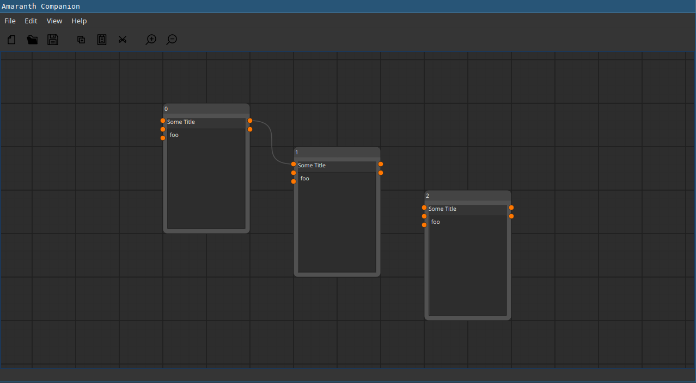
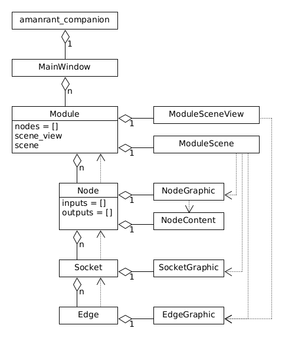

# Amaranth Companion
Visual Editor for Gateware based on [amaranth-lang](https://github.com/amaranth-lang/amaranth)

## Project Status
This project is currently still in the early stages of development.
The current goal is a GNU Radio Companion style block architecture on top of
amaranth, working towards recreating the
[blink example](https://github.com/cyber-murmel/amaranth-examples) with
simulation and formal verification.

- [x] GUI
  - [x] editor
    - [x] elements
      - [x] node
      - [x] socket
      - [x] edge
    - [x] functionality
      - [x] movement
      - [x] selection
      - [x] add
      - [x] delete
  - [x] light / dark / system theme
  - [x] python syntax highlighting in code blocks
  - [x] errors reported on the line they came from
  - [x] simulate to a waveform and open gtkwave
  - [x] choose a board, bind ports to its IOs, build and flash
- [ ] blocks
  - [x] block definitions (`*.block.yml`) and a library
  - [x] ports derived from amaranth source by name suffix
  - [x] hierarchical blocks, opened by double click
  - [x] port blocks
  - [x] logic gates (NOT, AND, OR, XOR)
  - [x] variable blocks and parameter wiring
  - [x] icons for hierarchical blocks
  - [x] testbench blocks
  - [x] formal blocks
- [x] backend
  - [x] reading a block's interface out of amaranth
  - [x] generating an amaranth package from a design
  - [x] simulation as unit tests
  - [x] formal verification as unit tests
  - [x] `python -m <package>` simulates and writes a waveform
  - [x] `python -m <package> build` makes a bitstream

### Blocks

A block carries amaranth `Elaboratable` source, and its ports are read back
out of that source. The role of a port comes from a name suffix:

| suffix | meaning |
| --- | --- |
| `_in` | input signal port |
| `_out` | output signal port |
| `_param` | parameter port: an elaboration-time value such as a bit width |
| anything else | internal to the block, not a port |

Parameters are declared as `*_param` keyword arguments of `__init__`. Ports
are derived by instantiating the class in a subprocess, so a width that
depends on a parameter -- `Signal(range(half_period))` -- resolves to its real
value, and faulty block code cannot take the editor down with it.

Blocks are resized by their bottom-right corner, and renamed by
double-clicking the title (or `F2`). The wheel scrolls a code block while the
pointer is inside it and zooms the canvas everywhere else; `Ctrl`+wheel always
zooms.

A **port block** makes a signal into a port of the block it sits inside.
There are three to place -- Input, Output and Parameter -- and which one you
placed is what decides the direction; the name is only a name. The suffix is
added for you, so a port called `a` on an input becomes `a_in` on the parent
and `self.a_in` in the generated Amaranth.

A hierarchical block contains a child graph; the port blocks inside it become
its ports. Double-clicking its body opens it, and it may carry an SVG icon drawn on the
node -- the shipped gates use the usual logic symbols.

A testbench block sits in the same graph as the implementation it exercises
and drives the block that graph *is*. It defines one coroutine:

```python
async def testbench(ctx, dut):
    ctx.set(dut.a_in, 1)
    await ctx.tick()
    assert ctx.get(dut.o_out) == 0
```

A formal block sits beside the same implementation and states what must
*always* hold, rather than what happens for one stimulus:

```python
MODES = ("bmc", "cover", "prove")
DEPTH = 20

def formal(m, dut):
    m.d.comb += Assert(dut.blinker.counter < dut.blinker.half_period)
    m.d.comb += Cover(dut.blink_out == 1)
```

Each mode is a separate check, which is why the blink example has three.
Amaranth removed `FHDLTestCase.assertFormal` along with `Past`, `Rose`, `Fell`
and `Stable`, so the editor carries its own prover; where the original spec
reached for `Past(x)`, the shipped one keeps an explicit delay register, which
is what `Past` compiled down to anyway.

`View -> Run Tests` runs every testbench and formal block in the design and
reports on the blocks. Formal blocks are skipped, not failed, when `sby` and
`yosys` are not installed.

### Hardware

`Build -> Board` lists every platform installed on this machine -- the 90-odd
boards from `amaranth-boards`, and the Glasgow revisions if the `glasgow`
package is present. The choice is stored in the design.

An **I/O block** binds a design port to a pin on that board. Its socket faces
whichever way the IO does: an LED is something the design drives, so the block
takes an input; a button hands a value over, so it gives an output. Write
`led 0` for a resource the board can hand out, or `LED0` for a pin the
platform exposes directly -- recent Glasgow revisions claim their LED pins at
construction, so those come out as named ports rather than requestable
resources. Either spelling resolves to whichever the installed board package
offers, so a design does not break when that package is updated. Append `:i`
or `:o` to a bidirectional pin to say which way you meant it.

A board whose package is not installed is reported on the block and otherwise
left alone -- the port and its wiring stay exactly as saved, so opening a
design on the wrong machine cannot quietly edit it.

`Build -> Build Bitstream` (`F8`) synthesises; `Build and Program`
(`Shift+F8`) also loads it onto an attached board. The generated package can
do the same without the editor:

```
python -m blink build                      # synthesise for the design's board
python -m blink build --platform ... --program
```

Building needs the toolchain for the chosen family -- `yosys`, `nextpnr-ice40`
and `icestorm` for an iCE40 board such as the Glasgow. The nix shell provides
them. The Glasgow platform is not on PyPI (the name there is a placeholder). The
nix shell builds it: `pkgs.glasgow` is a `buildPythonApplication`, which hides
the importable module, so `shell.nix` puts it back with `toPythonModule` and
rebuilds it for the python the shell uses. The first `nix-shell` after that
change takes a few minutes. Outside nix:

```
pip install "glasgow @ git+https://github.com/GlasgowEmbedded/glasgow#subdirectory=software"
```

The two routes give different Glasgow revisions, which expose the LEDs
differently -- `led 0` on the nixpkgs one, `LED0` on git `main`. Either
spelling works in a block; the generator emits whichever call the installed
revision needs.

#### Programming

The bitstream is built first and loaded on second, rather than asking the
platform to do both in one call: a board that cannot be reached must not cost
a bitstream that took minutes and is perfectly good. A failed program says
where the bitstream is and what went wrong with the board.

Two things are smoothed over on the way, both in platforms that reach their
board over USB through asyncio:

- `asyncio.get_event_loop()` used to make a loop on demand and now raises
  without one, which no platform could have known. A loop is made before the
  programmer is called.
- Glasgow's platform, at the time of writing, calls `asyncio.get_event_loop`
  in a module that never imports `asyncio`, so programming raises `NameError`
  before reaching the hardware. The name is supplied, with a warning, when the
  module really is missing it. The honest fix is upstream -- one `import
  asyncio` in `glasgow/hardware/platform/__init__.py`.

### Waveforms

`View -> Simulate...` runs the design for a number of clock cycles, writes a
VCD beside the design file, and opens GTKWave on it -- splash suppressed,
zoomed to fit, and showing the signals that matter: the clock and reset first,
then the design's ports and its submodules' internal state.

`File -> Export Amaranth...` writes the design out as a package laid out like
the example repository, with the checks as an ordinary pytest file. The prover
and the simulator are copied into the package rather than imported, so the
generated tests and `python -m <package>` work in CI with the editor nowhere
in sight:

```
python -m blink --clocks 200          # simulate and open the waveform
python -m blink --clocks 200 --no-open   # just write blink.vcd and blink.gtkw
python -m pytest blink                # simulation and formal tests
```

### Making your own blocks

A block is a `*.block.yml` beside an ordinary module file -- the same pair the
shipped gates use, so nothing about a built-in block is privileged. Its
interface comes from the port blocks in the module, so there is nothing to
declare.

`Insert -> Create Block from Module...` writes what is on the canvas out as
one. Blocks are looked for beside the design file first (`blocks/` next to the
`.json`) and then in `~/.config/amaranth-companion/blocks`, so a project can
carry a changed copy of a block without editing everybody else's.

### Sample projects

`File -> Open Example` opens one of the designs shipped with the editor. They
open untitled, so saving one asks where to put it rather than writing back
into the installed package.

| Example | What it shows |
| --- | --- |
| Logic Gates | the four shipped gates; double-click one to see how it is built |
| NAND from AND and NOT | composing hierarchical blocks, with a shared width variable |
| Parameterised Bus | ports resizing from a variable |
| Blinker | the blink example rebuilt as blocks: a clocked counter with `period_param` |

Each of the last three carries a testbench, so `View -> Run Tests` on a freshly
opened example goes green.

A variable block holds one assignment, `width = 8`, and hands the value out on
a parameter port. Variables may be written in terms of each other
(`half = period // 2`) in any order. Wiring one into a block's `*_param` port
is what sets the value that block elaborates with, so changing a variable
visibly resizes the ports downstream of it.

### Panels

Two docks flank the canvas, both switchable under `View -> Panels`. They
appear with a design and go away with it, since neither has anything to show
without one; hiding one is remembered across opening and closing designs.

The **Hierarchy** on the left is the whole design at once: the root module and
every hierarchical block under it, however deep. A block goes by its own title,
so renaming one renames its row. Clicking a row goes there, so a block three
levels down is one click rather than three double-clicks.

The path bar above the canvas still shows the way *in* to where you are. It is
there even at the root, where it is a single entry naming the design.

The **Blocks** palette on the right lists everything the library offers,
grouped the way the Insert menu groups it. Drag a block onto the canvas to
place it where you dropped it, or double-click it to place it mid-view.

Two blocks on one canvas never go by the same name. The second AND gate
numbers them both -- the one already there becomes `AND0` and the newcomer
`AND1` -- and the next is `AND2`. Numbering only starts on a collision, so a
lone gate is left reading `AND`, and a gap left by a deletion is filled before
the count goes on. The number names the instance, not the kind: both gates
still generate one `class AND`, instantiated as `and0` and `and1`.

Dragging a node *out* of the canvas and onto the palette deletes it --
putting it back in the box. Dropping it anywhere else does nothing, so a
design does not lose a block to a slip of the wrist, and the deletion goes
through the history like any other edit, so `Ctrl-Z` brings it back.



## Structure


## Development

The nix shell provides everything, including `yosys` and `sby` for formal
verification:

```
nix-shell
python -m pytest
python -m pytest --cov        # with a coverage report
python -m amaranth_companion
```

Coverage follows the worker subprocesses -- introspection, simulation, formal
checking and waveform runs all happen in a `python -m` child, which is most of
the point of them. `tests/conftest.py` sets `COVERAGE_PROCESS_START` for that;
without it the most carefully tested code in the project reads as untested.

Tests that need `sby`, `yosys` or `gtkwave` skip when they are absent, so the
suite is green either way -- but coverage of `verify/` is only meaningful with
them installed.

## Attribution
- [amaranth-lang](https://github.com/amaranth-lang/amaranth)
- [Node Editor in Python Tutorial Series](https://www.blenderfreak.com/tutorials/node-editor-tutorial-series/)

### References
- [Icestudio](https://icestudio.io/)
- [GNU Radio Companion](https://wiki.gnuradio.org/index.php/Guided_Tutorial_GRC)
